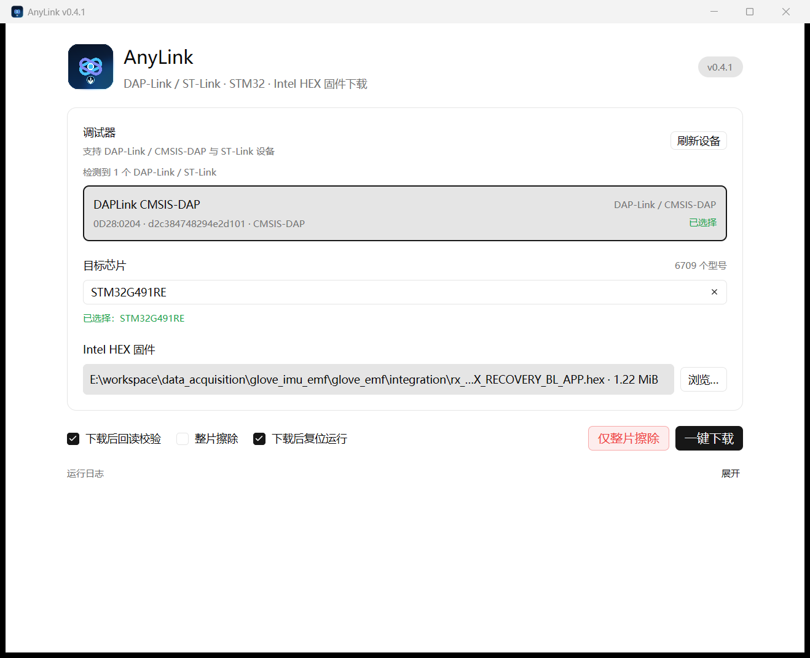

# AnyLink

基于 Rust、GPUI Fast / GPUI Kit 和 probe-rs 的 DAP-Link / ST-Link 固件下载工具。

当前版本面向 Windows，支持：

- 检测并选择 DAP-Link / CMSIS-DAP 或 ST-Link / ST-Link V2/V2-1/V3 调试器
- 通过可搜索下拉框选择 probe-rs 目标芯片，输入内容仅用于快速过滤
- 只显示 `.hex` 文件的固件选择对话框
- 兼容含空行、异常 CR 换行、BOM 或行首尾空格的 Intel HEX 文件
- 下载前先校验 HEX 记录和地址范围，再连接调试器
- 默认擦除固件覆盖的必要 Flash 扇区，也可选择整片擦除
- 写入并可选回读校验，成功后默认复位并运行目标
- 支持只执行整片擦除、不下载固件
- 自动恢复上次固件路径，并记住文件选择器上次打开的目录
- 后台执行擦除或下载，界面保持响应
- 显示阶段、进度、日志和可操作的错误信息
- 页面内容超过窗口高度时自动滚动
- 记住上次调试器、芯片、HEX 文件和擦除选项
- 独立版本号与 Windows 文件版本信息



## 环境要求

- Windows 10 / 11 x64
- Rust stable（本项目使用 Rust 1.98）
- DAP-Link（CMSIS-DAP v1 或 v2）或 ST-Link
- 已连接且供电正常的目标板

## 构建和运行

```powershell
cargo run --release
```

或者执行完整检查、构建并生成 zip 包：

```powershell
.\scripts\build.ps1
```

生成文件：

```text
dist/AnyLink-v0.4.1-Windows-x64.zip
```

发布目录同时包含 GUI 程序 `anylink.exe` 和不打开窗口的诊断工具
`anylink-cli.exe`。双击 `anylink.exe` 不会弹出命令行终端。

## 使用方法

1. 连接 DAP-Link / ST-Link 和目标板。
2. 启动 AnyLink，点击“刷新设备”并选择调试器。
3. 打开“目标芯片”下拉框，输入 `STM32H743ZI` 快速过滤，然后点击匹配项。
4. 点击“浏览…”选择 `.hex` 固件，文件选择器会过滤非 HEX 文件。
5. 根据需求选择“下载后回读校验”“整片擦除”和“下载后复位运行”。
   - “下载后复位运行”默认开启，可在本次操作前取消
6. 点击“一键下载”。

上次选择的固件路径会自动恢复，并在启动日志中显示。后续重新选择文件时，文件对话框会定位到上次固件所在目录。

“整片擦除”选项作用于本次下载，默认关闭。启用后界面会显示红色警告。

如只需要清空芯片：

1. 选择调试器和目标芯片，无需选择 HEX。
2. 点击“仅整片擦除”。
3. 在红色确认区再次点击“确认整片擦除”。

“仅整片擦除”不会下载固件，且无法撤销。成功下载后目标默认仍保持暂停；勾选“下载后复位运行”后才会自动复位并运行。

配置保存在：

```text
%APPDATA%\AnyLink\config.json
```

后续启动会自动恢复上次配置，减少重复选择。

## 硬件诊断

确认 DAP-Link 和目标芯片可以连接，但不擦写 Flash：

```powershell
target\release\anylink-cli.exe --check STM32H743ZI
```

使用 HEX 文件验证解析、目标连接和 Flash 布局，同样不擦写：

```powershell
target\release\anylink-cli.exe --dry-run examples\dry-run-demo.hex STM32H743ZI
```

仅校验 HEX 文件，不连接任何硬件：

```powershell
target\release\anylink-cli.exe --validate-hex .\RX_RECOVERY_BL_APP.hex
```

仅整片擦除目标芯片（不下载固件）：

```powershell
target\release\anylink-cli.exe --erase-chip STM32H743ZI
```

查看版本：

```powershell
target\release\anylink-cli.exe --version
```

GUI 的 DRY RUN 模式：

```powershell
$env:ANYLINK_DRY_RUN = "1"
cargo run --release
```

该模式仍会连接目标并验证 HEX/Flash 布局，但不会擦除或写入 Flash。正常启动时不设置此环境变量。

> `examples/dry-run-demo.hex` 只用于解析和布局测试，不是可运行固件，请勿用于实际下载。

如果 HEX 中没有任何数据落在目标 Flash 区域，程序会在擦除前停止，并提示检查 Intel HEX 扩展地址记录。例如 STM32 的 `0x08000000` 基地址需要 `:020000040800F2`。

## 实现结构

```text
src/
├── main.rs              # GUI 程序入口（Windows GUI 子系统）
├── bin/anylink-cli.rs   # 独立命令行诊断工具
├── app.rs               # GPUI 页面、状态机、后台任务和进度更新
├── config.rs            # 配置读写
└── backend/
    └── mod.rs           # DAP-Link / ST-Link 枚举、芯片解析、擦除和下载
assets/
├── logo.png             # 界面 Logo
└── logo.ico             # Windows 程序图标
examples/
├── probe_smoke.rs       # 最小 probe-rs 调试器/目标连接诊断
├── flash_once.rs        # 命令行真实烧录诊断
├── read_flash.rs        # 回读目标 Flash 用于验证
├── h743-test-loop.hex   # STM32H743 最小复位循环测试固件
├── g491-test-loop.hex   # STM32G491 最小复位循环测试固件
└── dry-run-demo.hex     # 安全的 HEX 解析测试文件
```

## 版本管理

版本号的唯一来源是 `Cargo.toml`：

- 窗口标题和界面右上角显示当前版本
- Windows 可执行文件属性中写入 FileVersion / ProductVersion
- 发布目录和 zip 文件名包含版本号
- `CHANGELOG.md` 记录每个版本的变更

升级版本：

```powershell
.\scripts\bump-version.ps1 0.3.0
```

脚本会更新 `Cargo.toml` 并执行 `cargo check`。随后补充 `CHANGELOG.md` 并运行
`scripts\build.ps1` 生成版本化发布包。

下载流程：

```text
GPUI 按钮
  └─ 独立工作线程
       ├─ 枚举并打开指定 DAP-Link / ST-Link
       ├─ attach 目标芯片
       ├─ 解析 Intel HEX
       ├─ 擦除所需 Flash 扇区或整片擦除
       ├─ 写入
       ├─ 可选校验
       ├─ 可选复位并运行
       └─ 通过异步 channel 更新进度和最终结果
```

默认下载选项：

- `verify = true`：下载后回读校验
- `do_chip_erase = false`：默认只擦除固件覆盖范围所需的 Flash 扇区
- 开启“整片擦除”后使用 `do_chip_erase = true`，优先调用芯片整片擦除功能
- `reset_after_flash = true`：默认下载后调用核心复位并运行，取消勾选可保持暂停
- 失败时不继续执行校验或运行固件
- “仅整片擦除”使用 probe-rs 的 mass-erase 流程，不依赖 HEX 文件

## 已验证

本机实测环境：

- DAP-Link：`VID_0D28 / PID_0204`，CMSIS-DAP v2，序列号 `d2c384748294e2d101`
- STM32H743ZI：真实下载、校验、整片擦除和回读验证通过
- STM32G491RE：真实“仅整片擦除”和“下载后复位运行”验证通过
  - 仅整片擦除耗时约 101 ms
  - 擦除后 `0x08000000` 和 `0x0807FFF0` 均回读为 `FF`
  - 下载 767 字节测试固件耗时约 143 ms
  - 下载后独立读取核心状态为 `Running`
  - 回读测试标记：`0x08000020: CA FE BA BE`
- HEX 不含目标 Flash 数据时会在擦除前拒绝下载
- `RX_RECOVERY_BL_APP.hex` 的异常双 CR/空行格式已成功校验：
  - 16384 条数据记录
  - 524288 字节
  - 地址范围 `0x08000000–0x08080000`
- ST-Link 驱动与设备枚举代码已编译通过；当前环境没有 ST-Link 硬件，尚未做真机验证
- 11 个单元测试通过，包括 HEX 容错、旧配置默认复位运行和 ST-Link / CMSIS-DAP 设备识别测试
- `cargo clippy --all-targets -- -D warnings` 通过

当前 G491RE 测试板运行最小 `B .` 循环固件，不初始化外设；如需恢复业务固件，直接使用原始 HEX 再次下载即可。

独立回读测试：

```powershell
cargo run --example read_flash -- STM32G491RE 0x08000000 48
```

## 当前限制

- 仅支持 Intel HEX，不支持 ELF、BIN、UF2
- 支持 DAP-Link / CMSIS-DAP 和 ST-Link，不支持 J-Link、FTDI 等其他调试器
- 不自动猜测芯片型号，需要手动选择一次并记住
- 不支持在线调试、RTT、固件取消或量产模式
- probe-rs 内置目标库不支持的芯片暂不能下载
- 写入会擦除固件覆盖的 Flash 扇区，请确认目标板上的原有数据可被覆盖
- “仅整片擦除”和多核目标目前只复位主核心（core 0）
